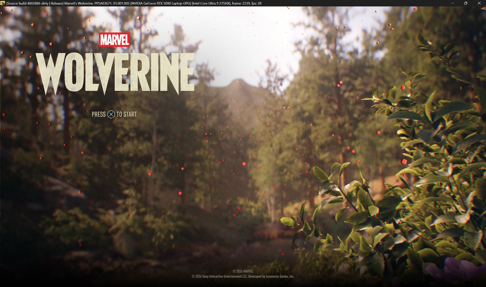
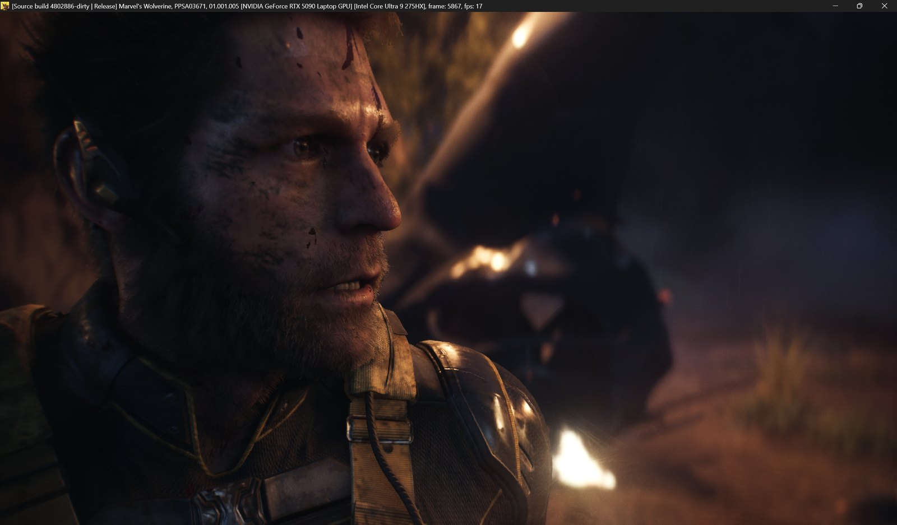
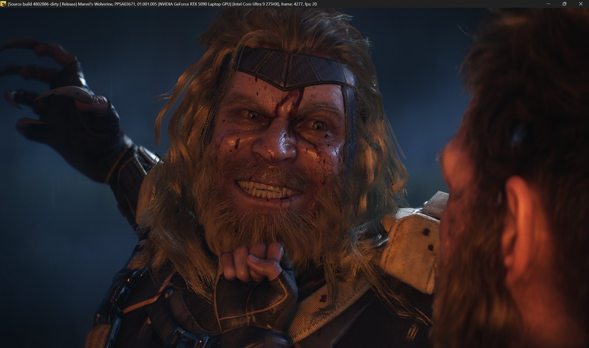
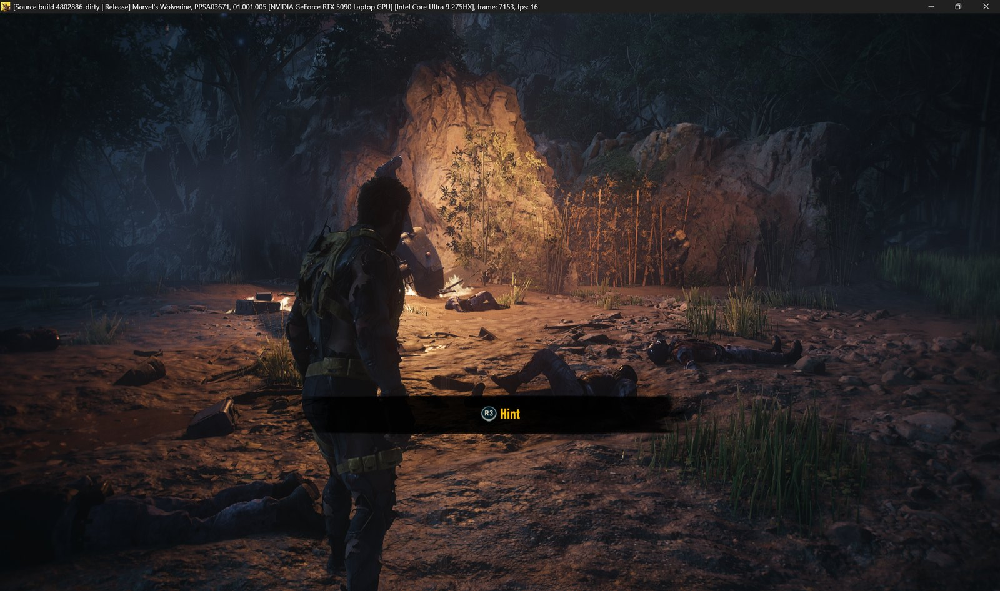
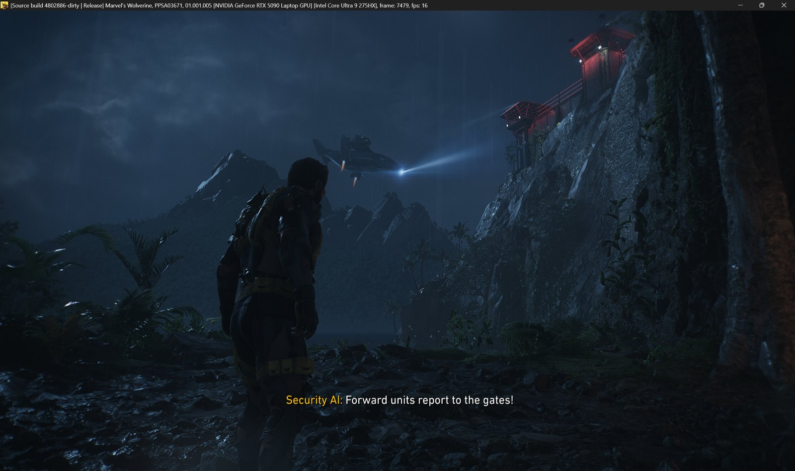
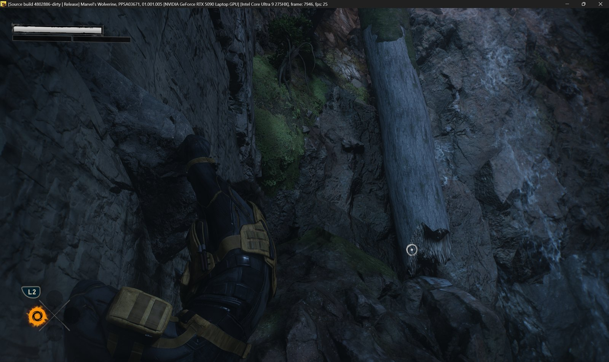
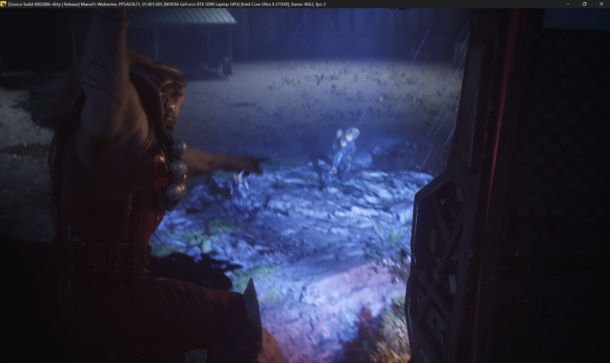

# KytyPS5-Frank

> **Experimental, no support promised.** This is a personal test build. It may crash, and issues may go unanswered.

Hello, this emulator is built with Claude using the open source code from various emulators (I'm not a developer, just trying to help).
I'm testing it only on Marvel's Wolverine for now, the tests are all done on my laptop which has a Core Ultra 9 275HX - RTX 5090 Laptop - 64GB DDR5-5600.
I'm sharing this for anyone who wants to try it and add to it, if you can help us with the issues we're facing that would be awesome.
This is where it stands right now:

## Where it stands (October 18, 2026)

**Game:** Marvel's Wolverine (PPSA03671, version 01.001.005), Performance mode.

| Scene | FPS |
|---|---|
| Title screen | 24–28 |
| Opening cutscene | 24–28 |
| Jungle gameplay | 16–21 |
| Heavy action scenes | 9–15 |

Target: 60 FPS in Performance mode, 30 in Fidelity.

### Screenshots

The FPS is in each window title (Performance mode, RTX 5090 Laptop). Click a picture for full size.

| | |
|---|---|
|  |  |
| Title screen, 28 FPS (the red dots are the particle bug below) | Cutscene, 17 FPS |
|  |  |
| Cutscene, 20 FPS | Jungle gameplay, 16 FPS |
|  |  |
| Jungle gameplay, 16 FPS | Climbing, 25 FPS |

**Working:** boots, menus, cutscenes and gameplay, with correct terrain, foliage, lighting and ray-traced passes.

### What this build changes compared with KytyPS5

Visual fixes:
- **Terrain rendered as flat sand.** Bindless samplers lost their texture key and all used sampler record 0 (point filtering, clamped). The key is now kept.
- **Particle masks missing.** The particle shader samples 2D-array textures through 3D image instructions, as the hardware allows. They were rejected and replaced by a blank texture, so particles drew as squares. They are now read as 2D arrays.
- **Wrong placeholder textures** after bindless slots were freed.

Speed:
- **Hardware denormal flushing** instead of software flushes in every float operation. The heaviest pixel shader went from 5.9 ms to 0.96 ms per frame.
- **No barriers between compute dispatches the game doesn't order**, and no NVIDIA crash-marker per draw. Title screen ~10 → ~20 FPS.
- **Faster tracking of GPU-written memory** (pages processed in runs). Title ~19.5 → ~23, gameplay ~15 → ~17 FPS.
- **Ray-traversal shader loop cap** (dc76e1223a9bf673) so runaway rays stop early. Gameplay ~7 → ~13 FPS at the time.
- **GPU-sized buffers, resource-table reads and shader function expansion** reworked to avoid waiting on the GPU and to reuse work. Function expansion alone was 8% of the command thread.

Stability:
- **Render-thread crash in streaming scenes fixed.** The game asks the memory manager (AMM) to map memory and writes into it shortly after. Each map took ~0.35 ms here, because our table of memory ranges was copied and re-sorted on every change. Batches queued up for half a second, and the game wrote into memory that wasn't mapped yet. The table is now an ordered map, and each batch's unmaps go to the GPU thread in one trip.
- **Fewer stalls when the game frees memory in batches.** Each unmap in a batch made its own round trip to the GPU thread (and its own GPU submission). They now go in one trip per batch: a 512-unmap batch went from 58 ms to about 7 ms.
- **Game threads no longer wait on buffer copies.** The GPU thread held the memory locks while it copied whole buffers from guest memory, up to 64 ms, and the game's main, render and job threads waited on those locks. The copy now runs after the locks are released.
- **BVH refit "device lost" fixed.** It came from reads of data still being downloaded.
- **Many diagnostics, all off by default:** frame timeline, GPU timing, crash reports that name the guest memory mapping, shader probes.

## Known issues and caveats

- **Tested only on Marvel's Wolverine, and only on an NVIDIA RTX 5090 Laptop.** AMD and Intel GPUs and other games are untested.
- **Occasional GPU "device lost" crash.** A shader reads a GPU address outside any buffer. The crash report now names the address; the cause is under investigation.
- **Occasional freeze.** The game can stop responding in some scene changes, for example the drop-off scene below (frame counter stuck, two threads spinning at 100%). Restarting gets past it. Under investigation.

  
- **Red squares and red streaks instead of some particles** (title screen, rain and embers in some scenes). The particle shader (ES `4efbcf79c36d8adf`) adds GS user-data slot 28 (s36) to the instance ID to pick its one 16-byte record. The game sets slot 28 with a 29-register `SET_SH_REG` whose last dword is leftover command-buffer data on some frames (`0x00100011`, even a PM4 header), so the index lands past the record and the shader reads zeros. Forcing it to 0 gives the correct soft particles. What we've ruled out: the dword doesn't change in the 40 ms after we parse it, the GPU doesn't write it, and the draw (`DRAW_INDEX_INDIRECT_MULTI`, no base-vertex/start-instance/draw-index register) writes no user data. So either the real GPU doesn't load that register for this shader, or it treats that out-of-range index differently. It's a good place to help if you know RDNA2 merged ES/GS user SGPRs or PS5 command buffers.
- **You need your own legally dumped copy of the game.** No games or system files are provided or linked.

## Where we're struggling, and what we tried

**The frame rate is held back by waits, not by one slow part.** Measured in jungle gameplay:
- The game submits a frame, then waits until the emulator has translated it and the GPU has run it.
- The game's 5 job threads stop about 9 times a frame to read GPU results. Each read is a full GPU round trip; on a PS5 the CPU and GPU share memory, so it costs nothing there.
- The GPU spends about 20 ms per frame on the game's shaders and about 30 ms on everything between them (copies, barriers, syncs). The frame is split into about 160 GPU submissions (about 62 for the game's graphics submissions, 46 for its compute submissions, 45 periodic flushes), but halving them didn't help, so the cost is in the work between the shaders rather than the number of submissions. We haven't broken that 30 ms down yet.
- The command processor (one thread) needs about 40 ms per frame for ~2,400 draws and dispatches.

**Tried, with little or no FPS change:**
- Making the command thread ~25% faster.
- Skipping game-thread readback waits entirely (measurement only).
- Snapshot reads: average read wait 4.5 → 1.9 ms.
- Skipping repeated buffer syncs.
- A draw-preparation thread.
- Deferring dispatches whose resource tables the GPU just wrote.
- Halving the GPU submissions (about 160 → 75 per frame) by recording back-to-back game submissions into one: slightly slower, because the game's readbacks then wait longer (`KYTY_COALESCE_SUBMITS=1`).
- Flushing draws to the GPU less often (every 64 or 256 draws instead of 16): slower.

Each of these sped up one part, but the frame still waits on the next link in the chain.

**Next:**
1. Group game-thread reads into one GPU sync.
2. Put buffers the game reads back every frame in memory both the CPU and GPU can reach (Resizable BAR), so reads need no copy.
3. Check how many frames ahead the game may run compared with a real PS5.
4. Spread command processing across CPU cores.

## How to run

Needs 64-bit Windows 10/11, a CPU with AVX2 (Intel Haswell from 2013 or AMD Zen, and newer) and a Vulkan 1.3 GPU with a recent driver.

1. Download the latest `KytyPS5-Frank-...-win64.zip` from the [Releases](../../releases) page and unzip it.
2. You need your own legally dumped copy of the game. No games or system files are provided or linked.
3. Open `Play.bat` in a text editor and set `GAME` to your game folder (the one with `eboot.bin`).
4. Double-click `Play.bat`. The log goes to `kyty_log.txt` next to it. `launcher.exe`, the KytyPS5 launcher, works too.

The settings tuned for Wolverine are built in. To start with plain KytyPS5 settings, set the environment variable `KYTY_FRANK_DEFAULTS=0`.

### Building from source

Same as KytyPS5 (see their build instructions); this repository is a fork of it. The tuned changes are on the default branch. On Windows, `build-release.bat` (tuned for your own CPU) and `build-portable.bat` (any AVX2 CPU, used for the download) build with Visual Studio Build Tools, clang-cl and Ninja; set `KYTY_QT_DIR` (Qt 6) and `KYTY_GLSLANG` (glslangValidator) first.

## Credits

- [KytyPS5](https://github.com/KytyPS5/KytyPS5): the base emulator.
- AnyPS5 and the Jetsku fork of KytyPS5: parts of the graphics work.
- Changes in this build were made by Claude (Anthropic) and tested by Mahmoud Neama.

Licensed under GPL-2.0, like KytyPS5.

Not affiliated with Sony Interactive Entertainment or PlayStation.

---

The original KytyPS5 README is in [README-KytyPS5.md](README-KytyPS5.md).
