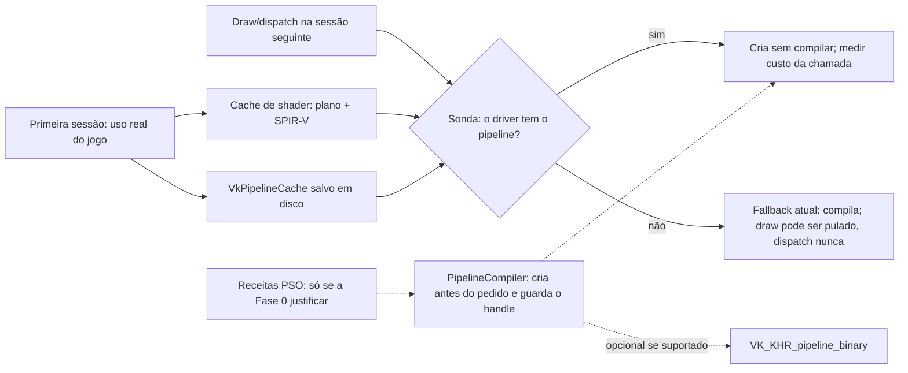

# Viabilidade de pré-aquecimento de shaders e pipelines Vulkan

**Escopo:** análise do código atual do emulador, da especificação Vulkan/Khronos e de material oficial AMD GPUOpen. Esta proposta não altera o código do emulador.

O item 10 de [SHADER-STUTTER-PLAN.md](SHADER-STUTTER-PLAN.md) ("Banco de estados de pipeline") propõe o mesmo registro de receitas; este documento é a análise dele.

## Conclusão

É tecnicamente viável reduzir compilações no gameplay nas execuções seguintes, e a maior parte do mecanismo já existe. O `VkPipelineCache` é salvo em disco e, quando o driver já tem o pipeline pedido, a sonda o cria sem compilação nem espera explícita pela fila de workers. O custo dessa chamada ainda precisa ser medido. Uma nota diagnóstica no código registra 24 acertos e 233 misses em uma execução com cache quente e aponta SPIR-V diferente para um mesmo shader guest entre execuções. Isso indica identidade instável em parte dos casos, mas não demonstra que ela explica todos os misses.

O primeiro passo, portanto, é reproduzir os misses, separar suas causas e estabilizar a saída SPIR-V onde ela variar sem motivo. Isso deve elevar os acertos na segunda execução da mesma rota; a taxa exata depende também do estado completo do pipeline e do que o driver conservou no cache. Um registro de receitas PSO recriadas na inicialização só se justifica se, depois disso, a criação sob demanda ainda causar picos de frametime, por acertos caros ou misses de pipelines já observados.

Não é viável prometer a compilação completa de um jogo genérico antes de sua primeira execução. O emulador não conhece, antes de processar os comandos guest, todos os shaders carregados ou gerados em memória, as especializações derivadas de recursos e os estados de renderização que formarão cada `VkPipeline`. SPIR-V pré-gerado não contém o código de máquina do driver nem substitui a descrição completa do pipeline.

O resultado esperado, portanto, é gradual: a primeira execução alimenta os caches; uma execução posterior pode reaproveitar os pipelines vistos quando shader, estado e dados do driver coincidirem. Rotas, efeitos, shaders dinâmicos e estados nunca vistos continuam sujeitos a misses. Distribuir binários prontos não remove esse limite entre GPUs e drivers.

## O que o emulador faz hoje

### PS5 guest → SPIR-V

O `ProgramCache` recebe os parâmetros de shader montados a partir dos registradores e da memória guest. A chave em memória inclui estágio, hash, tamanho do código, estado estático e, para shaders com chamadas, código expandido. `Get` pode expandir funções, traduzir o programa, materializar os recursos/SRT e compilar uma permutação SPIR-V. A criação de `VkShaderModule` ocorre em `AddPermutation`.

Há dois registros por shader no cache em disco, sob `_ShaderCache/<title id>`:

- O registro de origem guarda o plano de recursos produzido pela tradução.
- O registro de permutação guarda SPIR-V e os metadados compilados necessários ao pipeline.

As chaves incluem código, dados de entrada do estágio, especialização e configuração do recompiler. A chave de sessão inclui `vendorID`, `deviceID` e opções do emissor, então o cache de shader atual não é tratado como universal entre GPUs. As entradas validam chave, formato e hash, e são gravadas por uma fila de escrita.

Referências: [`ProgramCache`](../src/graphics/host_gpu/renderer/pipeline/pipelineCache.cpp#L1784), [montagem da chave de origem](../src/graphics/host_gpu/renderer/pipeline/pipelineCache.cpp#L1965), [leitura e compilação das permutações](../src/graphics/host_gpu/renderer/pipeline/pipelineCache.cpp#L2517), [chave de sessão e registros](../src/graphics/host_gpu/renderer/pipeline/shaderDiskCache.cpp#L690), [formato dos registros](../src/graphics/host_gpu/renderer/pipeline/shaderDiskCache.cpp#L821).

### SPIR-V → `VkPipeline`

O pipeline gráfico é identificado por programas VS/PS, formatos dos attachments, vertex input e estados estáticos. Entre eles estão topologia, amostragem, blending, máscaras de cor e polygon mode. O emulador já move viewport, scissor, vários estados de profundidade/stencil e alguns estados de rasterização para dynamic state, mas o restante continua contribuindo para variantes distintas.

O `VkPipelineCache` do driver é salvo em `_PipelineCache/<title id>.bin`. O arquivo carrega uma assinatura Kyty, hash de integridade e o payload opaco do Vulkan. A assinatura verifica vendor, dispositivo, versão do driver e `pipelineCacheUUID`; o driver ainda pode rejeitar o payload. A gravação periódica ocorre a cada 120 segundos por padrão, além do encerramento, com arquivo temporário e rename. O arquivo aceito é limitado a 1 GiB.

Quando `pipelineCreationCacheControl` está disponível, o emulador já tenta criar um pipeline com `FAIL_ON_PIPELINE_COMPILE_REQUIRED`. Acerto no cache retorna sem compilar; miss volta ao caminho de criação normal, que pode enfileirar a compilação gráfica. Enquanto um pipeline gráfico compila em segundo plano, seus draws são pulados; um draw que passa do orçamento de espera também é pulado. O `PipelineCompiler` já prioriza jobs pedidos pelo draw. Sua fila de aquecimento (`Warm`) cria um pipeline só para encher o cache do driver e o destrói em seguida; roda um aquecimento por vez, apenas quando não há job na fila. O cache do driver, porém, só é consultado quando o runtime pede aquele pipeline; o arquivo não contém uma lista que o emulador possa percorrer para instanciar todos os `VkPipeline` no início.

Referências: [estado que compõe a chave](../src/graphics/host_gpu/renderer/pipeline/pipelineCache.h#L49), [chave gráfica](../src/graphics/host_gpu/renderer/pipeline/pipelineCache.h#L264), [assinatura do cache](../src/graphics/host_gpu/renderer/pipeline/pipelineCache.cpp#L104), [criação e validação do cache Vulkan](../src/graphics/host_gpu/renderer/pipeline/pipelineCache.cpp#L3574), [gravação periódica](../src/graphics/host_gpu/renderer/pipeline/pipelineCache.cpp#L3668), [workers e prioridade](../src/graphics/host_gpu/renderer/pipeline/pipelineCache.cpp#L1236), [fila de aquecimento](../src/graphics/host_gpu/renderer/pipeline/pipelineCache.cpp#L1268), [draws pulados durante a compilação](../src/graphics/host_gpu/renderer/pipeline/pipelineCache.cpp#L4482), [sonda de cache e fallback](../src/graphics/host_gpu/renderer/pipeline/pipelineCache.cpp#L4505), [uso de `FAIL_ON_PIPELINE_COMPILE_REQUIRED`](../src/graphics/host_gpu/renderer/pipeline/shaders.cpp#L804).

O app tem como alvo Vulkan 1.3 e habilita `pipelineCreationCacheControl` quando o dispositivo anuncia a feature. O código atual não usa `VK_EXT_pipeline_creation_feedback`, `VK_EXT_graphics_pipeline_library` ou `VK_KHR_pipeline_binary`, embora os headers Vulkan 1.4 vendorizados definam essas APIs. O feedback é núcleo do Vulkan 1.3 e pode ser usado sem habilitar extensão nem feature; as outras duas exigem verificação de suporte.

Referências: [versão-alvo](../src/graphics/host_gpu/graphicContext.h#L21), [feature de controle do cache](../src/graphics/presentation/window/vulkanWindow.cpp#L688), [feature habilitada no device](../src/graphics/presentation/window/vulkanWindow.cpp#L775), [headers Vulkan vendorizados](../3rdparty/Vulkan-Headers/include/vulkan/vulkan_core.h#L69).

### Preparação antecipada já existente

O `DrawPrepScanner` percorre submissões PM4 já enfileiradas, acompanha escritas de registradores e prepara a caminhada de recursos/SRT dos draws e dispatches conhecidos. Só lê bytes guest que ainda não foram escritos pela GPU; se o estado não puder ser provado ou estiver atrás do progresso da GPU, deixa o caminho normal cuidar dele. Esse scanner não chama `vkCreateGraphicsPipelines` e não é um inventário de todas as áreas futuras do jogo. Ele antecipa trabalho de shader e recursos dentro do fluxo de comandos disponível.

Tradução de shaders gráficos e criação de pipelines gráficos já podem usar workers; enquanto isso, o draw é pulado. Compute continua exigindo que o dispatch aguarde um pipeline não pronto; a opção assíncrona existente suspende e retoma o packet, sem descartar dispatches, pois ignorá-los poderia deixar dados sem escrita. Essa é a semântica correta para manter.

Referências: [scanner de draws](../src/graphics/guest_gpu/drawPrepScanner.cpp#L173), [preparação de estágios](../src/graphics/host_gpu/renderer/pipeline/pipelineCache.cpp#L3974), [caminhada SRT do scanner](../src/graphics/host_gpu/renderer/pipeline/pipelineCache.cpp#L3296), [tradução gráfica em workers e regra para compute](../src/graphics/host_gpu/renderer/pipeline/pipelineCache.cpp#L1459), [compute assíncrono sem pular dispatch](../src/graphics/host_gpu/renderer/pipeline/pipelineCache.cpp#L1077).

## Estratégias consideradas

| Estratégia | O que consegue antecipar | Limite | Avaliação |
|---|---|---|---|
| Extrair shaders estaticamente do executável do jogo e gerar SPIR-V | Algum código guest que já esteja no arquivo e seja estático | Não descobre código carregado/gerado em runtime, valores de especialização e o estado completo do pipeline. SPIR-V ainda requer compilação pelo driver | Não usar como solução geral |
| Continuar restaurando `VkPipelineCache` | Dados de pipelines vistos em execuções anteriores, consultados pela sonda | Não cria handles antes do primeiro pedido nem enumera entradas; a nota diagnóstica registra muitos misses e SPIR-V diferente entre sessões | **Recomendado primeiro**: já implementado; determinar as causas dos misses e medir |
| Registrar receitas PSO e recriá-las na próxima inicialização | Os mesmos pipelines já prontos antes do primeiro draw, poupando a criação sob demanda | Primeira sessão permanece fria; uma rota incompleta deixa misses; manter handles exige código novo (ver abaixo) | Só se a Fase 0 mostrar picos de frametime ligados à criação de pipelines conhecidos |
| Persistir `VK_KHR_pipeline_binary` | Binário opaco de cada pipeline conhecido, com chave consultável e gestão explícita | Ainda requer a descrição exata do pipeline e só é válido quando a chave global de compatibilidade do driver permite; suporte varia | Avaliar como otimização opcional após o caminho base |
| `VK_EXT_graphics_pipeline_library` e mais dynamic state | Reuso de partes de pipeline e menos combinações de estado | Não elimina o link final; exige novas regras de estado/features e validação visual extensa | Não usar na primeira fase; medir explosão de variantes primeiro |
| AMD Radeon GPU Analyzer (RGA) | Compilar/inspecionar SPIR-V e receitas `.gpso`/`.cpso` com backend AMD, ver ISA e estatísticas | Ferramenta de análise/desenvolvimento; o resultado não é um cache portátil de `VkPipeline` do emulador | Útil para diagnóstico AMD, não como arquitetura runtime |

### Por que o caminho de receitas é tecnicamente viável

Uma pipeline pode ser criada sem executar um draw. O dado faltante é a descrição completa que `vkCreateGraphicsPipelines` ou `vkCreateComputePipelines` consome: módulos/permutação SPIR-V, layout, render-target formats, vertex input e todos os estados estáticos. O emulador já monta esses dados em `GraphicsPipelineBuild` e `ComputePipelineWarm` no momento em que observa a pipeline.

A mudança necessária é guardar uma representação serializada dessas receitas junto da identidade dos estágios e uma prioridade baseada na ordem/frequência de uso. Na próxima inicialização há duas formas de usá-las:

- **Aquecer só o cache do driver**, pela fila `Warm` atual, que cria o pipeline e o destrói. Para pipelines de uma execução anterior isso não acrescenta nada: o `VkPipelineCache` salvo já os contém.
- **Manter os pipelines prontos.** Exige código novo. A cache normal (`m_graphics_pipelines`) usa como chave ids de programa contados a partir do zero em cada execução (`++next_shader_id`), que não existem na inicialização. Seriam necessários uma busca por identidade estável (hashes de SPIR-V + estado), um modo da fila que guarde o handle em vez de destruí-lo e um limite de memória.

Nos dois casos os builders do runtime continuam os mesmos, o que reduz o risco de diferenças entre criação antecipada e criação sob demanda.

O registro precisa ser explícito, versionado e limitado: campos serializados um a um, sem gravar structs C++ com padding ou handles Vulkan. A identidade tem de cobrir o código/permutações SPIR-V, layout, estado de renderização, configurações do recompiler e conteúdo/versão do jogo. Entrada incompatível ou corrompida é ignorada e o pipeline segue pelo caminho normal.

Referências: [ids por execução](../src/graphics/host_gpu/renderer/pipeline/pipelineCache.cpp#L1885), [chave com esses ids](../src/graphics/host_gpu/renderer/pipeline/pipelineCache.cpp#L4189), [aquecimento que destrói o pipeline](../src/graphics/host_gpu/renderer/pipeline/pipelineCache.cpp#L4494).

## APIs Khronos e AMD GPUOpen

### Khronos

- **`VK_EXT_pipeline_creation_cache_control`** já é usado pelo emulador. Ele permite pedir ao driver que não compile durante a sonda e retorne `VK_PIPELINE_COMPILE_REQUIRED` em um miss. Isso move o custo para outro momento/worker; não elimina a compilação. Referência: [especificação Khronos da extensão](https://github.com/KhronosGroup/Vulkan-Docs/blob/main/appendices/VK_EXT_pipeline_creation_cache_control.adoc).
- **`VK_EXT_pipeline_creation_feedback`** (núcleo no Vulkan 1.3, sem feature a habilitar) registra por pipeline se houve acerto no cache e o tempo de criação: basta encadear `VkPipelineCreationFeedbackCreateInfo` na criação. É a instrumentação indicada para a Fase 0, para provar o ganho e encontrar pipelines caros; não é, por si só, um cache nem uma pré-compilação. Referência: [especificação da extensão](https://docs.vulkan.org/refpages/latest/refpages/source/VK_EXT_pipeline_creation_feedback.html).
- **`VK_KHR_pipeline_binary`** (Vulkan 1.4 ou dependência compatível) permite calcular uma chave da descrição do pipeline, capturar/recarregar binários do driver e geri-los por entrada. Isso é útil para uma cache incremental por PSO. A chave só pode ser calculada a partir de um `VkPipelineCreateInfo` conhecido; portanto, não descobre pipelines nunca vistos. Tratar os dados como específicos da implementação e conferir a chave global antes de reaproveitar entre devices. O alvo do emulador continua em Vulkan 1.3 e o código atual não enumera/habilita a extensão: deve ser um caminho opcional, ativado somente por capability check. Referências: [amostra Khronos de pipeline binaries](https://docs.vulkan.org/samples/latest/samples/extensions/pipeline_binary/README.html), [especificação](https://docs.vulkan.org/refpages/latest/refpages/source/VK_KHR_pipeline_binary.html).
- **`VK_EXT_graphics_pipeline_library`** divide a pipeline gráfica em quatro bibliotecas e depois as linka. Ajuda quando estágios e estados se repetem, mas o pipeline executável ainda tem de ser linkado; não deve ser confundido com persistência final sem trabalho de criação. Dynamic state pode reduzir a cardinalidade das chaves onde o estado guest já é atualizado corretamente por draw. Referência: [guia Khronos de graphics pipeline libraries](https://github.com/KhronosGroup/Vulkan-Guide/blob/main/chapters/ways_to_provide_spirv.adoc).

### AMD GPUOpen

O artigo de port de *Detroit: Become Human* relata que uma cache de shader gerada antes não removeu stutter porque o driver ainda precisava converter shaders em código GPU. A equipe então gerou os pipelines completos na primeira inicialização; havia cerca de 99.500 pipelines e o preparo levou de dois minutos em uma máquina de 64 threads a mais de vinte minutos em PCs mais fracos. É uma demonstração direta de que o método funciona quando existe um inventário exato, e de que aquecer tudo pode tornar a inicialização impraticável. Referência: [GPUOpen, Porting Detroit: Become Human, Part 1](https://gpuopen.com/learn/porting-detroit-1/).

RGA aceita SPIR-V e receitas Vulkan `.gpso`/`.cpso`, cria uma instância Vulkan e tenta compilar a pipeline no driver escolhido. Isso é apropriado para examinar ISA/uso de recursos e depurar receitas. Não substitui o cache persistente do aplicativo: é ferramenta externa, voltada a análise, e o modo offline não reproduz com a mesma precisão a compilação real do driver. Referência: [manual RGA, projetos Vulkan](https://gpuopen.com/manuals/rga_manual/help_manual/).

## Compatibilidade e custos

### Compatibilidade

- **`VkPipelineCache`:** manter por título e dispositivo/driver. O código já confere `vendorID`, `deviceID`, `driverVersion` e `pipelineCacheUUID`, além de deixar o driver rejeitar um payload inválido. Não distribuir o blob como universal.
- **Cache de shader:** os registros atuais incluem `vendorID` e `deviceID` na chave de sessão e opções de emissor/recompiler. Só reutilizar quando essa chave e a versão do formato/recompiler coincidirem.
- **Receita PSO:** o manifest pode ser independente do driver se guardar a descrição sem handles, mas a criação tem de ocorrer no device atual. Vincular ao hash de conteúdo do jogo, à versão do formato, ao hash dos estágios/SPIR-V e aos estados exatos.
- **Pipeline binary:** guardar a chave binária e a chave global obtidas do device. Se a chave global ou a feature não forem aceitas, descartar a entrada e usar `VkPipelineCache`/compilação normal. Não presumir compatibilidade AMD ↔ NVIDIA, entre modelos de GPU ou entre drivers.
- **Versão do emulador:** o blob atual não invalida automaticamente em toda build; isso é intencional porque o driver pode reutilizar pipelines se a descrição completa não mudou. O manifest próprio deve invalidar quando mudar sua serialização ou a interpretação da receita.

### Impacto esperado

| Recurso | Impacto provável | Mitigação/medição |
|---|---|---|
| Inicialização/load | Aumenta pelo tempo de recriação dos PSOs escolhidos. Pré-aquecer tudo pode levar minutos | Warm-up assíncrono e priorizado; limite de tempo/PSOs por tela de carregamento; manter miss no caminho normal |
| CPU | O trabalho total de compilação não desaparece; é deslocado para antes do gameplay e paralelizado. Muitos workers podem competir com threads do jogo/emulador | Usar a fila atual, limitar workers de background e interromper a preferência de warm-up quando surgirem jobs urgentes |
| RAM | Manifest pequeno; shaders, metadata e handles dos pipelines quentes ocupam memória do processo/driver | LRU/top-N; medir working set e número de handles |
| VRAM/memória do driver | O driver pode manter código e estado interno. Não se deve assumir que o custo seja zero só porque não há texturas guest carregadas | Medir orçamento e uso de memória do dispositivo durante e após warm-up |
| Armazenamento | `VkPipelineCache` atual tem limite de arquivo de 1 GiB. Receitas são pequenas comparadas a binários, mas pipeline binaries podem adicionar dados por entrada | Limites por título/device, checksum, escrita atômica e limpeza por versão/idade |
| FPS | Cache hit e pipeline pronto removem espera de criação no draw; worker de fundo pode reduzir headroom de CPU/GPU | Comparar P95/P99 e FPS médio sob rota idêntica; priorizar gameplay sobre warm-up |

## Riscos principais

1. **Receita incompleta ou chave instável:** vira miss silencioso ou recria estado incorreto. Serializar todos os campos efetivos do create info e descartar entradas que não passem validação.
2. **Cobertura parcial:** caminho, câmera, efeitos e especializações não vistos continuam compilando durante gameplay. Manter fallback sem pular draws/dispatches; atualizar a cobertura em cada sessão.
3. **Caches que mudam entre sessões:** há uma nota de diagnóstico no código indicando que, em uma medição de warm run, 24 probes acertaram e 233 compilaram; ela também registra hashes SPIR-V diferentes entre execuções para um mesmo shader guest. Reproduzir o caso e quantificar a contribuição de cada causa antes de usar a taxa de acerto como prova de viabilidade.
4. **Warm-up competir com trabalho urgente:** o aquecimento não pode segurar a thread GPU nem tomar todos os workers. Integrar à prioridade já existente e parar/ceder quando gameplay solicitar pipeline.
5. **Cache interrompido/corrompido:** usar formato versionado, checksum, arquivo temporário + rename e fallback a cache vazia.
6. **Diferença de backend/feature:** mudanças em bindless, formato de recurso, subgroup, dynamic state ou capabilities podem gerar SPIR-V/layout diferentes. Incluir capabilities relevantes na identidade da sessão e ignorar caches incompatíveis.
7. **Custo de startup maior que o stutter evitado:** aquecer apenas top-N e pipelines da introdução/primeira área; ampliar cobertura com dados medidos.
8. **Extensões opcionais:** `VK_KHR_pipeline_binary` e GPL dependem de suporte do driver e das features habilitadas. Falta de extensão precisa resultar em fallback simples, não em bloqueio do jogo.

O ponto 3 decide o plano. A saída SPIR-V estável é necessária para reaproveitar as mesmas entradas; ainda é preciso conferir estado, persistência e comportamento do driver. Um manifest não resolve uma identidade que muda entre execuções equivalentes.

## Arquitetura recomendada

Reusar `ProgramCache`, `PipelineCache`, os builders atuais de `VkPipelineCreateInfo` e `PipelineCompiler`. Se as receitas forem justificadas, a parte nova não é só o armazenamento: inclui a busca por identidade estável e o modo da fila que guarda o handle (ver acima). Não introduzir um serviço paralelo de shaders nem uma API pública de pré-compilação até haver necessidade demonstrada.

### Plano de implementação

#### Fase 0 — estabilizar a identidade e decidir

- Repetir uma rota determinística com cache frio e quente, no mesmo device/driver/build, com `KYTY_PIPELINE_MISS_LOG=1`. O log já existe: para cada miss, imprime os hashes guest e SPIR-V dos estágios, o hash do estado estático, o de rendering e o resultado da sonda. O hash de estado cobre bytes crus, padding incluído, então uma diferença só nele pode ser ruído.
- Comparar os hashes SPIR-V de cada hash guest entre as duas execuções e corrigir a saída instável se ela for reproduzida. Conferir também se o miss veio de driver/cache UUID diferente, estado diferente ou shader de fato diferente.
- Encadear `VkPipelineCreationFeedbackCreateInfo` (núcleo no Vulkan 1.3) para obter, por pipeline, acerto no cache e tempo de criação. Medir também o tempo que draws aguardam e quantos draws são pulados.
- Critério para avançar à Fase 1: após corrigir as causas reproduzidas, a criação sob demanda de pipelines já observados ainda coincide com picos de frametime P95/P99, seja por acertos caros ou por misses persistentes. Se a rota vista não apresentar esse custo, o `VkPipelineCache` existente já atende a esse caso.

Referência: [log de misses](../src/graphics/host_gpu/renderer/pipeline/pipelineCache.cpp#L4541).

#### Fase 1 — persistir receitas de pipelines observados (só se a Fase 0 justificar)

- No ponto em que `GraphicsPipelineBuild`/`ComputePipelineWarm` já foi montado, gravar uma receita versionada com identidade dos shaders, layout/metadata, rendering formats e estados efetivos.
- Gravar valores campo a campo; não persistir ponteiros, handles nem bytes de structs C++ com padding.
- Guardar ordem/frequência do primeiro uso para priorizar telas de carregamento e a rota mais comum.
- Associar o manifest ao título/conteúdo, versão do formato, configuração de recompiler e capabilities que alteram shader ou pipeline.
- Persistir com checksum, limite de tamanho, arquivo temporário e rename; entrada inválida é ignorada.

#### Fase 2 — aquecer receitas na próxima sessão

- Após escolher o device e carregar as opções do jogo, validar o manifest e abrir os registros SPIR-V correspondentes.
- Recriar módulos/layouts com os builders normais e enviar receitas para o `PipelineCompiler` como trabalho de fundo, num modo novo que guarde o handle (a fila `Warm` atual o destrói) e o registre sob a identidade estável, para o draw encontrá-lo antes de existirem os ids de programa da execução.
- Reutilizar a fila urgente existente; priorizar primeiro a intro/menu e promover um job quando o jogo pedir o mesmo pipeline.
- Manter os handles na cache normal; limite de warm-up por tempo/contagem e política de descarte para não reter todo o jogo em memória.
- Para misses, erros e shaders dinâmicos, preservar o fallback atual: o draw pode ser pulado enquanto o pipeline compila, o dispatch nunca. O aquecimento não pode criar novos casos de draw pulado.

#### Fase 3 — API de binários opcional

- Experimentar `VK_KHR_pipeline_binary`: verificar extension/feature/dependências, armazenar key global + key/binário e recriar com binário. Comparar tempo, tamanho de disco e aceitação após atualização de driver.
- O fallback obrigatório continua sendo o caminho Vulkan 1.3 com `VkPipelineCache` existente.

#### Fase 4 — reduzir variantes, somente com dados

- Contar quais campos estáticos produzem mais variantes por shader.
- Testar dynamic state suportado pelo dispositivo para esses campos; exigir comparação visual e de FPS para cada mudança.
- Testar `VK_EXT_graphics_pipeline_library` apenas se o custo de link ou recompilação de combinações repetidas continuar alto. Não incluir no primeiro protótipo.

## Critérios de sucesso e validação

Comparar a mesma build, device, driver, save e rota em cache frio, warm só com `VkPipelineCache` (depois da Fase 0) e, se houver, warm com receitas. Medir:

- frametime P95/P99 e FPS médio durante introdução, primeira área e uma troca de área;
- compilações/misses durante gameplay, tempo total de `vkCreate*Pipelines`, tempo que draws aguardam e número de draws pulados (o jogador vê isso como geometria faltando);
- tempo adicional de carregamento, CPU de fundo, working set/RAM, orçamento de VRAM e bytes nos dois caches;
- cobertura: proporção dos pipelines da rota que estavam no manifest e foram prontos antes da primeira solicitação;
- imagens/referências de cenas e comportamento de gameplay para confirmar que o pipeline reproduz o mesmo estado.

Aceitar somente quando o frametime P95/P99 e a contagem de compilações durante gameplay caírem de forma repetível, sem diferenças gráficas, perda relevante de FPS médio ou aumento de inicialização/memória que invalide a melhoria. Primeiro reporte de misses deve separar shader novo, variante de estado, cache incompatível e falha de warm-up.

## Fontes oficiais

- [Khronos Vulkan Specification — Pipelines e cache](https://docs.vulkan.org/spec/latest/chapters/pipelines.html)
- [Khronos — `VK_EXT_pipeline_creation_cache_control`](https://github.com/KhronosGroup/Vulkan-Docs/blob/main/appendices/VK_EXT_pipeline_creation_cache_control.adoc)
- [Khronos — `VK_EXT_pipeline_creation_feedback`](https://docs.vulkan.org/refpages/latest/refpages/source/VK_EXT_pipeline_creation_feedback.html)
- [Khronos — amostra `VK_KHR_pipeline_binary`](https://docs.vulkan.org/samples/latest/samples/extensions/pipeline_binary/README.html)
- [Khronos — `VK_KHR_pipeline_binary`](https://docs.vulkan.org/refpages/latest/refpages/source/VK_KHR_pipeline_binary.html)
- [Khronos Vulkan Guide — Graphics Pipeline Library](https://github.com/KhronosGroup/Vulkan-Guide/blob/main/chapters/ways_to_provide_spirv.adoc)
- [AMD GPUOpen — Porting Detroit: Become Human, Part 1](https://gpuopen.com/learn/porting-detroit-1/)
- [AMD GPUOpen RGA Manual — Vulkan projects](https://gpuopen.com/manuals/rga_manual/help_manual/)
